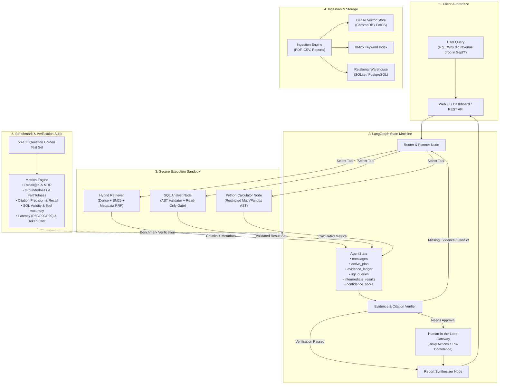
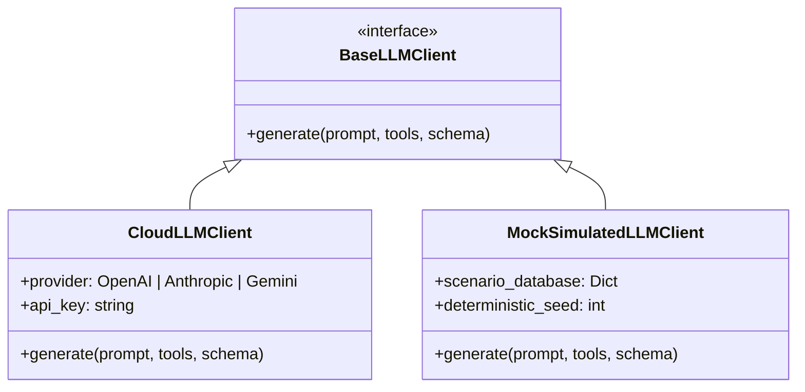

# Technical Architecture & Specification: Evidence-Based AI Research Agent

## 1. Executive Summary & Objective

The **Evidence-Based AI Research Agent** is an enterprise-grade agentic system designed to answer complex business, quantitative, and analytical queries by orchestrating heterogeneous tools—combining unstructured document intelligence, structured relational SQL analytics, and Python computations—while enforcing strict evidence citations, reliability safeguards, and measurable performance benchmarks.

---

## 2. High-Level System Architecture



---

## 3. Data Ingestion & Hybrid Retrieval Pipeline

### 3.1 Document Ingestion Schema
Incoming documents (PDFs, corporate reports, CSV tables, financial disclosures) are ingested with hierarchical contextual chunking:

```typescript
interface DocumentChunk {
  chunk_id: string;             // UUIDv5 based on document hash + index
  document_id: string;          // Identifier of source document
  document_name: string;        // Human-readable title (e.g., 'Q3_Financial_Review.pdf')
  document_type: 'pdf' | 'csv' | 'markdown' | 'text';
  page_number: number | null;   // Exact page in original PDF
  section_title: string;        // Inferred or parsed heading hierarchy
  content: string;              // Primary text or serialized markdown table
  token_length: number;
  metadata: {
    fiscal_quarter?: string;
    department?: string;
    date_published?: string;
    table_headers?: string[];
  };
}
```

### 3.2 Hybrid Retrieval Strategy (Reciprocal Rank Fusion - RRF)
To prevent hallucination on domain-specific terminology, code terms, and exact numbers, retrieval uses dual-stream ranking:
1. **Dense Semantic Retrieval:** Cosine similarity over vector embeddings ($E_{query} \cdot E_{doc}$).
2. **Sparse Keyword Retrieval:** BM25 algorithm scoring exact token matches, ticker symbols, product codes, and dates.
3. **Reciprocal Rank Fusion (RRF):**
   $$RRF\_Score(d) = \sum_{m \in \{dense, bm25\}} \frac{1}{k + rank_m(d)}$$
   (where $k \approx 60$ smoothing constant).
4. **Metadata Filtering:** Hard predicates applied prior to re-ranking (e.g., `fiscal_year == 2024 AND quarter == 'Q3'`).

---

## 4. LangGraph Agent State Machine

### 4.1 State Definition (`AgentState`)

```python
from typing import TypedDict, List, Dict, Any, Optional

class EvidenceItem(TypedDict):
    source_id: str             # e.g., "doc_chunk_104" or "sql_query_42"
    source_title: str          # e.g., "Q3 Earnings Report (Page 14)"
    quote_or_datapoint: str    # Exact excerpt or aggregate metric
    relevance_rationale: str   # Why this evidence supports the hypothesis

class AgentState(TypedDict):
    question: str
    chat_history: List[Dict[str, str]]
    plan_steps: List[str]
    current_step_index: int
    tool_scratchpad: List[Dict[str, Any]]
    retrieved_documents: List[Dict[str, Any]]
    executed_sql: List[Dict[str, Any]]
    python_calculations: List[Dict[str, Any]]
    evidence_ledger: List[EvidenceItem]
    verification_attempts: int
    is_evidence_sufficient: bool
    requires_human_approval: bool
    approval_prompt: Optional[str]
    final_report: Optional[Dict[str, Any]]
```

### 4.2 State Nodes & Transition Logic

1. **`plan_and_route` (Node):**
   - Parses the user's objective.
   - Decomposes into factual sub-questions (e.g., "Extract quantitative sales figures by region" $\to$ SQL; "Retrieve executive commentary on supplier bottlenecks" $\to$ RAG).
2. **`execute_rag` (Node):**
   - Queries hybrid index; extracts chunks with page and section identifiers.
3. **`execute_sql` (Node):**
   - Transpiles natural language query into dialect-specific SQL.
   - Routes through the **SQL Reliability Validator**.
4. **`execute_python` (Node):**
   - Performs variance calculations, growth rates, regressions, or table aggregations in a restricted sandbox.
5. **`evidence_verifier` (Node / Guardrail):**
   - Cross-checks whether the assembled data in `evidence_ledger` directly proves the claims needed to answer the question.
   - If evidence is missing, triggers re-retrieval (loops back to `plan_and_route` with updated context, max 3 loops).
6. **`human_in_the_loop_gate` (Node):**
   - Invoked if a high-impact query requires external human review (e.g., sensitive records access, high ambiguity, or anomaly detection flags).
7. **`synthesize_report` (Node):**
   - Emits structured markdown report featuring:
     - **Executive Summary**
     - **Quantitative Evidence Table** (with exact SQL sources)
     - **Qualitative Rationale** (with exact doc & page citations)
     - **Limitations & Unresolved Nuances**

---

## 5. Reliability Controls & Sandboxing

### 5.1 SQL Security & Execution Sandbox
To guarantee zero-risk data warehouse querying:
- **AST-Based Parser:** Uses `sqlglot` or `sqlparse` to inspect AST before execution.
- **Whitelist Enforcement:** Only `SELECT` statements are permitted. `DROP`, `DELETE`, `UPDATE`, `INSERT`, `ALTER`, `TRUNCATE`, `EXEC`, and multi-statement queries (`;`) are rejected immediately.
- **Table Whitelist:** Only predefined analytical views/tables can be queried.
- **Resource Limits:** Queries are capped at `LIMIT 500`, with a 3.0-second execution timeout.
- **Read-Only Database Credentials:** Agent operates under a dedicated non-superuser role with `GRANT SELECT` only.

### 5.2 Python Math & Analytics Sandbox
- Executed in an isolated subprocess with restricted builtins (`math`, `statistics`, standard Python data types, and read-only `pandas`).
- `os`, `sys`, `subprocess`, socket operations, and file writing are strictly disallowed.

### 5.3 Groundedness & Anti-Hallucination Guardrail
- Every claim in the final synthesis must map to an item in `evidence_ledger`.
- Bracket citations like `[Source: DocName, p.14]` or `[Data: SQL-Query-1]` are validated against the actual execution log.
- Uncited claims trigger an automatic rewrite loop in the synthesizer.

---

## 6. Dual-Mode LLM Abstraction

To ensure deterministic testing, zero-cost CI/CD runs, and seamless production deployment:



- **Cloud Mode:** Pluggable adapters for `OpenAI` (`gpt-4o`), `Anthropic` (`claude-3-5-sonnet`), and `Google Gemini` (`gemini-1.5-pro`/`flash`).
- **Simulated / Mock Mode:** Built-in zero-dependency deterministic engine that uses intent matching and golden state sequences. Allows running the complete 50-100 question evaluation test suite offline without consuming API tokens.

---

## 7. Comprehensive Evaluation Benchmark Suite

To empirically prove the research agent's capabilities without unsubstantiated claims:

### 7.1 Golden Evaluation Dataset (50–100 Test Cases)
Each test case contains:
```typescript
interface EvaluationSample {
  id: string;                     // e.g., "EVAL_042"
  category: 'financial_anomaly' | 'operational_root_cause' | 'cross_document_synthesis' | 'sql_heavy' | 'pure_rag';
  question: string;               // Realistic business question
  expected_tool_sequence: string[]; // e.g., ["execute_sql", "execute_rag", "execute_python"]
  expected_sql_tables: string[];  // e.g., ["monthly_revenue", "regional_sales"]
  gold_retrieval_chunk_ids: string[]; // Relevant document chunks
  gold_ground_truth_answer: string;
  gold_citations: Array<{ source: string; page?: number }>;
  expected_metrics: {
    revenue_september?: number;
    pct_decrease?: number;
  };
}
```

### 7.2 Measured Evaluation Metrics

| Metric | Target Standard | Measurement Method |
| :--- | :--- | :--- |
| **Retrieval Recall@K** | $\ge 0.85$ (K=5) | $\frac{|\text{Retrieved Chunks} \cap \text{Gold Chunks}|}{|\text{Gold Chunks}|}$ |
| **Retrieval MRR@K** | $\ge 0.75$ | Mean Reciprocal Rank of the first relevant chunk in search results |
| **Tool Selection Accuracy** | $\ge 0.92$ | Exact match & F1-score of agent-chosen tools vs. required data modalities |
| **SQL Execution Validity** | $\ge 0.95$ | Percentage of generated SQL queries that execute without syntax/permission errors |
| **Groundedness / Faithfulness**| $\ge 0.90$ | Automated NLI verification: percentage of generated statements entailing from evidence |
| **Citation Precision & Recall** | $\ge 0.90$ | Precision and recall of cited pages/tables matching ground truth sources |
| **Response Latency (P50/P90)** | $\le 4.5\text{s} / 8.5\text{s}$ | End-to-end clock time from query to verified report |
| **Token Cost Tracking** | Tracked per query | Total prompt + completion tokens logged and converted to USD equivalent |

---

## 8. Directory & File Structure Plan

```text
d:/New folder (2)/
├── ARCHITECTURE.md                  # Detailed Technical Design Specification (This Document)
├── config/
│   ├── config.py                    # Environment, model settings, security limits
│   └── prompts.py                   # System prompts for Router, SQL, RAG, Verifier, Reporter
├── data/
│   ├── sample_database.sqlite       # Sample business data (Revenue, orders, products, regions)
│   ├── documents/                   # Business reports (PDFs, Markdown, CSVs)
│   └── evaluation_benchmark.json    # 50-100 realistic golden evaluation questions
├── src/
│   ├── ingestion/
│   │   ├── document_parser.py       # PDF/CSV parser and chunker
│   │   └── hybrid_index.py          # BM25 + Dense vector storage & RRF search
│   ├── agent/
│   │   ├── state.py                 # LangGraph AgentState and schemas
│   │   ├── router.py                # Planning and routing node
│   │   ├── graph.py                 # LangGraph workflow definition & conditional edges
│   │   └── verifier.py              # Evidence ledger validation and citation checker
│   ├── tools/
│   │   ├── rag_tool.py              # Hybrid retrieval tool interface
│   │   ├── sql_sandbox.py           # SQL generation, AST validation, execution sandbox
│   │   └── python_sandbox.py        # Safe math and aggregation executor
│   ├── providers/
│   │   ├── llm_factory.py           # Factory resolving Cloud vs. Mock providers
│   │   ├── cloud_client.py          # OpenAI / Anthropic / Gemini wrapper
│   │   └── mock_client.py           # Deterministic zero-cost offline test provider
│   └── web/
│       ├── server.py                # FastAPI backend serving agent workflows & eval API
│       └── static/                  # Modern responsive dashboard UI
└── evaluation/
    ├── run_benchmark.py             # Evaluation suite runner calculating all metrics
    └── benchmark_report.md          # Generated empirical evaluation report
```

---

## 9. Implementation Roadmap

1. **Phase 1: Core Engine & Data Foundations**
   - Populate `sample_database.sqlite` with comprehensive business data (multi-year revenue, product hierarchies, regional sales, returns).
   - Ingest business reports (quarterly earnings reports, board memos, supplier notices).
   - Construct the `HybridIndex` (BM25 + Dense Vector embeddings).
2. **Phase 2: Sandboxed Tools & State Machine**
   - Implement `sql_sandbox.py` with strict AST parsing and read-only guarantees.
   - Build `python_sandbox.py` for mathematical verification.
   - Assemble `LangGraph` state graph (`graph.py`, `state.py`, `verifier.py`).
3. **Phase 3: Evaluation Suite & Benchmark Runner**
   - Create the 50–100 question evaluation test set in `data/evaluation_benchmark.json`.
   - Implement `run_benchmark.py` to calculate Recall@K, Groundedness, Citation Accuracy, SQL validity, latency, and cost.
4. **Phase 4: Dual-Mode Provider Integration & Web UI**
   - Provide seamless switching between Cloud LLM and Offline Mock Simulator.
   - Launch FastAPI backend with interactive dashboard for research exploration and live benchmark reporting.
