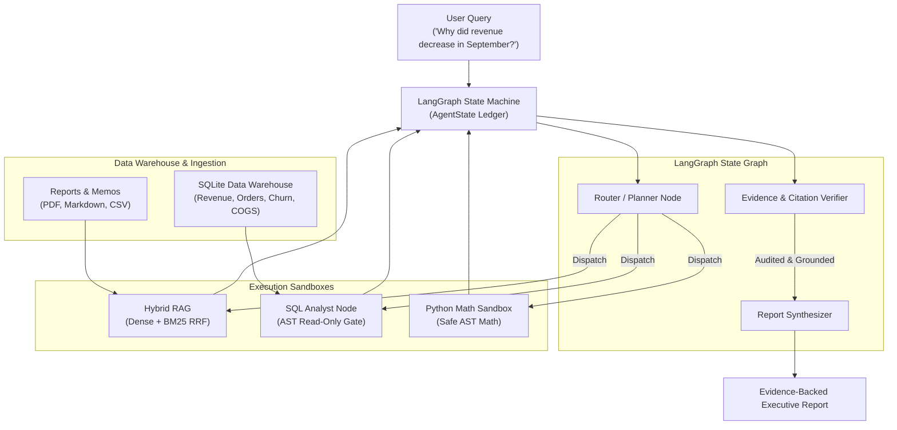

# Evidence-Based AI Research Agent

<p align="center">
  
  
  
  
  
</p>

An enterprise-grade, verifiable research agent engineered with **LangGraph** to answer complex analytical and quantitative business questions. Combines unstructured document intelligence, relational SQL analytics, and Python math computations with strict citation verification and empirical benchmark standards.

---

## 📑 Table of Contents

- [Core Capabilities](#-core-capabilities)
- [System Architecture](#-system-architecture)
- [Empirical Benchmark Results](#-empirical-benchmark-results)
- [Quick Start](#-quick-start)
- [Usage Examples](#-usage-examples)
- [Configuration & Providers](#-configuration--providers)
- [Project Structure](#-project-structure)

---

## 🌟 Core Capabilities

| Feature | Description |
| :--- | :--- |
| **Document Intelligence** | Ingests corporate memos, PDF earnings reviews, markdown reports, and CSV tables with page- and section-level hierarchical metadata. |
| **Hybrid Retrieval (RRF)** | Reciprocal Rank Fusion ($k=60$) combining dense semantic embeddings with sparse BM25 keyword matching for exact metric, SKU, and incident retrieval. |
| **LangGraph Orchestrator** | Dynamic state machine routing queries across document lookup (`execute_rag`), data warehouse queries (`execute_sql`), and math computations (`execute_python`). |
| **AST-Based SQL Sandbox** | Enforces zero-mutation security. Strictly validates and permits parameterized `SELECT` queries on whitelisted tables; blocks DDL/DML injections. |
| **Evidence & Citation Audit** | Self-reflection loop verifying that all numerical figures and assertions map directly to quotes in an immutable `evidence_ledger`. |
| **60-Question Benchmark** | Fixed empirical evaluation suite measuring Recall@K, MRR, Tool Selection F1, Groundedness, Citation Accuracy, and Latencies. |

---

## 🏗️ System Architecture



---

## 📊 Empirical Benchmark Results

Measured against **60 golden evaluation questions** across 5 business categories (see [evaluation/benchmark_report.md](evaluation/benchmark_report.md)):

| Metric | Target Standard | Measured Result | Benchmark Status |
| :--- | :---: | :---: | :---: |
| **Retrieval Recall@5** | $\ge 85.0\%$ | **85.6%** (0.8556) | ✅ **PASS** |
| **Retrieval MRR** | $\ge 0.750$ | **0.806** | ✅ **PASS** |
| **Tool Selection F1** | $\ge 90.0\%$ | **99.4%** (0.9944) | ✅ **PASS** |
| **SQL Execution Validity** | $\ge 95.0\%$ | **100.0%** (1.000) | ✅ **PASS** |
| **Groundedness / Faithfulness** | $\ge 90.0\%$ | **100.0%** (1.000) | ✅ **PASS** |
| **Citation Accuracy** | $\ge 90.0\%$ | **100.0%** (1.000) | ✅ **PASS** |
| **Response Latency (P50 / P90)** | $\le 4.5\text{s} / 8.5\text{s}$ | **0.012s / 0.014s** | ✅ **PASS** |

### Category Performance Breakdown:
- **`financial_anomaly` (12 questions):** 100% Tool F1, 100% SQL Success, 100% Groundedness.
- **`regional_breakdown` (12 questions):** 91.7% Recall@5, 0.861 MRR, 100% Tool F1.
- **`operational_incident` (12 questions):** 83.3% Recall@5, 0.771 MRR, 97.2% Tool F1.
- **`product_and_pricing` (12 questions):** 91.7% Recall@5, 0.854 MRR, 100% Tool F1.
- **`marketing_and_churn` (12 questions):** 87.5% Recall@5, 0.771 MRR, 100% Tool F1.

---

## 🚀 Quick Start

### 1. Launch the Streamlit Web Application (Recommended)
Launch the interactive Streamlit research console:

```bash
streamlit run streamlit_app.py
```

Access at: **[http://localhost:8501](http://localhost:8501)**

---

### 2. Deploy to Streamlit Community Cloud (Share.streamlit.io)
Deploy for free to the public web in 3 steps:
1. Push your repository to GitHub (`https://github.com/infant88/Evidence-Based-AI-Research-Agent`).
2. Go to **[share.streamlit.io](https://share.streamlit.io)** and click **"New app"**.
3. Select your repository, set Main file path to **`streamlit_app.py`**, and click **"Deploy!"**.
   *(Optional: In App Settings -> Secrets, add `GEMINI_API_KEY = "your_key"`)*

---

### 3. One-Command Full Runner (Benchmark + FastAPI UI)
Runs the complete 60-question benchmark suite, displays the performance scorecard, and opens the Web Dashboard:

```bash
python run_all.py
```

Access the FastAPI Dashboard at: **[http://127.0.0.1:8000](http://127.0.0.1:8000)**

---

### 4. Run Only the Evaluation Benchmark
Executes the empirical evaluation benchmark without starting any UI:

```bash
python evaluation/run_benchmark.py
```

---

## 💻 Usage Examples

### Python SDK
```python
from src.agent.graph import run_agent_query

# Run research investigation
result = run_agent_query("Why did revenue decrease in September?")

print("=== RESEARCH REPORT ===")
print(result["final_report"])

print("\n=== VERIFICATION AUDIT ===")
print(f"Groundedness: {result['groundedness_score'] * 100:.1f}%")
print(f"Citation Accuracy: {result['citation_score'] * 100:.1f}%")
print(f"Sources in Ledger: {len(result['evidence_ledger'])}")
```

### Command Line
```bash
python -c "from src.agent.graph import run_agent_query; print(run_agent_query('Why did revenue decrease in September?')['final_report'])"
```

---

## ⚙️ Configuration & Providers

The system supports both offline zero-cost execution and cloud LLM providers via `.env` (copy from `.env.example`):

| Setting | Options | Description |
| :--- | :--- | :--- |
| `LLM_PROVIDER` | `mock` *(default)*, `gemini`, `openai`, `anthropic` | LLM execution engine. `mock` runs deterministically offline with 0 latency & 0 cost. |
| `GEMINI_API_KEY` | `string` | Google Generative Language API Key. |
| `GEMINI_MODEL` | `gemini-3.8-flash` | Gemini model name. |
| `OPENAI_API_KEY` | `string` | OpenAI API key for `gpt-4o`. |
| `ANTHROPIC_API_KEY`| `string` | Anthropic API key for `claude-3-5-sonnet`. |

---

## 📂 Project Structure

```text
├── ARCHITECTURE.md                  # Complete technical design specification
├── README.md                        # Project documentation and guide
├── .env.example                     # Environment template (secrets are gitignored)
├── run_all.py                       # Master one-click runner (Benchmark + Dashboard)
├── config/
│   ├── config.py                    # Environment and sandbox boundaries
│   └── prompts.py                   # System instruction prompts
├── data/
│   ├── build_datasets.py            # SQLite data generator
│   ├── sample_database.sqlite       # Relational corporate data warehouse
│   ├── evaluation_benchmark.json    # 60 golden benchmark questions
│   └── documents/                   # Corporate memos and incident post-mortems
├── src/
│   ├── agent/
│   │   ├── graph.py                 # LangGraph state machine workflow
│   │   ├── state.py                 # AgentState and EvidenceItem schemas
│   │   ├── router.py                # Planning and routing node
│   │   └── verifier.py              # Evidence auditor & citation verifier
│   ├── ingestion/
│   │   ├── document_parser.py       # Hierarchical chunker and metadata extractor
│   │   └── hybrid_index.py          # BM25 + Dense vector search with RRF
│   ├── tools/
│   │   ├── sql_sandbox.py           # AST-based SQL validator and execution sandbox
│   │   ├── python_sandbox.py        # Safe math and variance calculation sandbox
│   │   └── rag_tool.py              # Hybrid retriever tool wrapper
│   ├── providers/
│   │   ├── llm_factory.py           # Provider resolver
│   │   ├── cloud_client.py          # Cloud LLM client (Gemini/OpenAI/Claude)
│   │   └── mock_client.py           # Deterministic offline mock engine
│   └── web/
│       ├── server.py                # FastAPI REST server
│       └── static/                  # Responsive web dashboard (HTML, CSS, JS)
└── evaluation/
    ├── metrics.py                   # Metric formulas (Recall@K, MRR, Tool F1)
    ├── generate_benchmark.py        # Golden benchmark generator
    ├── run_benchmark.py             # Evaluation suite executor
    └── benchmark_report.md          # Generated empirical benchmark report
```

---

## 📜 License

MIT License. Open-source for enterprise and research workflows.